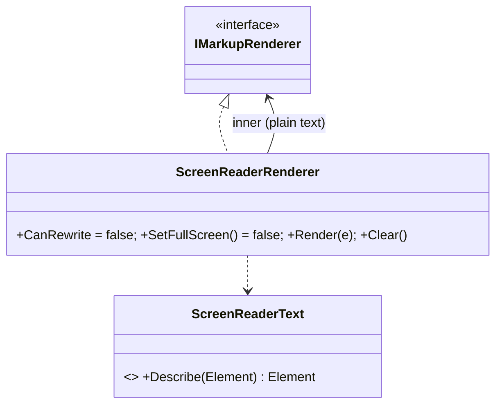

# Design: ConsoleMVC 1.28: Accessibility

| | |
|---|---|
| **Author** | Mateusz Podeszwa |
| **Status** | Implemented in 1.28.0 |
| **Scope** | `ScreenReaderRenderer`, `ScreenReaderText`, `MarkupRenderer.CreateForScreenReader`, `Theme.CreateHighContrast`, `MvcApplicationBuilder.ScreenReader` and `HighContrast` |

---

## 1. Problem

Screen readers read a terminal line by line. Box borders, table grids and bars are read out as strings of symbols
("box drawings light horizontal…"), screens erased with a clear vanish from the reader's history, and fields redrawn
in place with the arrow keys are never announced. Separately, dim and dark colours are hard to read for many people.

## 2. Screen-reader mode



```
ScreenReaderRenderer.Render(e) → inner.Render(ScreenReaderText.Describe(e))
    CanRewrite = false      → <select>, <radio>, <checkbox>, <number>, <date> ask for typed answers;
                              live regions draw their final state once; <scroll> draws everything
    Clear()                 → one blank line between screens (nothing is erased)
    SetFullScreen()         → false (the alternate screen hides the reader's history)

Describe(element):
    <box>        → its title, then its children
    <table>      → one line per row: "Header: value, Header: value" (cells alone without a header row)
    <columns>    → each column's children, one column after another
    <separator>  → nothing
    <progress>   → "Import: 75%"          <spinner> → "Connecting", or "Connected: done"
    <bar-chart>  → "Mon: 12" per bar      <sparkline> → "Load: 30 values from 10 to 89, latest 14"
    <shortcuts>  → "Shortcuts: F1 Help, Esc Back"    <breadcrumbs> → "You are here: Home, Orders"
    <markdown>   → no rules, quotes start with "Quote:"
    other containers → their children, described;  anything else → as it is
```

The inner renderer (`CreateForScreenReader`) writes plain text with no colours or cursor movement.

## 3. Choosing it

| Code | Setting | Effect |
|---|---|---|
| `builder.ScreenReader = true` | `ConsoleMVC:ScreenReader=true` | Wraps the renderer (also one set in `builder.Renderer`) in `ScreenReaderRenderer` |
| `builder.HighContrast = true` | `ConsoleMVC:HighContrast=true` | Uses `Theme.CreateHighContrast()`: bold, bright colours, no dim text, heavy panel borders |

The settings come from any configuration source, so users choose without a new build:
`dotnet run -- --ConsoleMVC:ScreenReader=true`, or `ConsoleMVC__ScreenReader=true` in the environment.
