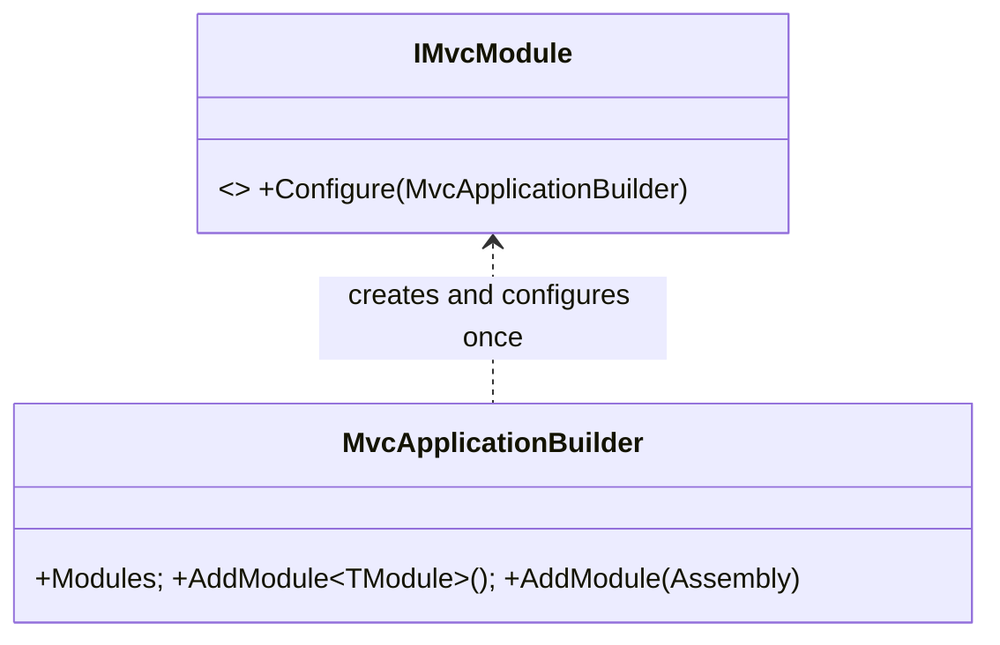

# Design: ConsoleMVC 1.30: Areas and modules

| | |
|---|---|
| **Author** | Mateusz Podeszwa |
| **Status** | Implemented in 1.30.0 |
| **Scope** | `AreaAttribute`, area route names in `Router`, `RouteValues.ParseTarget`, `RouteContext.Area`, `IMvcModule` and `MvcApplicationBuilder.AddModule`, area views in the generator and analyzer |

---

## 1. Problem

A large application has groups of screens (administration, reports, billing) whose controllers would collide by name
(`HomeController` in each) and whose views crowd one `Views` folder. Teams also want to ship a group of screens as a
class library and add it to several applications.

## 2. Areas

```
MyApp/
├── Controllers/HomeController.cs                       route: Home/…
├── Views/Home/IndexView.cvw
├── Views/Shared/_Layout.cvw                            partials and layouts, shared by every area
└── Areas/
    └── Admin/
        ├── Controllers/UsersController.cs              namespace MyApp.Areas.Admin.Controllers → route: Admin/Users/…
        └── Views/Users/IndexView.cvw                   namespace MyApp.Areas.Admin.Views.Users
```

```
ControllerKey(type) = (AreaOf(type) is a ? a + "/" : "") + name without "Controller"
AreaOf(type)        = [Area("…")] (inherited) ?? the namespace segment after the last "Areas" ?? none
view key            = namespace *.Areas.{A}.Views.{C} → "A/C/{Name}";  *.Views.{C} → "C/{Name}"

ParseTarget("Admin/Users/Index?id=1") → controller "Admin/Users", action "Index"
                                          (two parts: Controller/Action; one: the current controller's action)

Qualify(controller, current):                 # navigation, redirects and shortcuts
    controller has "/" or current is outside an area → controller
    current is "A/X" and the router knows "A/controller" → "A/controller"   (the area's own wins)
    otherwise → controller                                                  (the application's)
```

- `RouteContext.Area` and `ControllerName` split a route; breadcrumbs show the controller without its area.
- An unknown controller that exists in an area names the area route in its error message.
- The generator compiles `Areas/{Area}/Views/{Controller}/*.cvw` (also included by the package's build props) into
  `{Root}.Areas.{Area}.Views.{Controller}`; area folders must be identifiers (CVW002). `Areas/*/Views/Shared` is not a
  partial folder: partials and layouts come from the project's `Views/Shared`.
- CVW119, CVW120 and CVW121 know area routes and qualify a controller named without an area the same way; the
  CVW121 fix creates `Areas/{Area}/Views/{Controller}/{Name}View.cvw`.

## 3. Modules



```
AddModule<TModule>(): assembly of TModule, once → Modules; new TModule().Configure(builder)
Discover(): router.DiscoverAll(application assembly), then every module assembly (also after a hot reload)
```

A module is an ordinary class library that references `ConsoleMVC.Framework`: its `.cvw` views are compiled in the
library, its partials are its own, and its controllers usually sit in an area named after the module.
