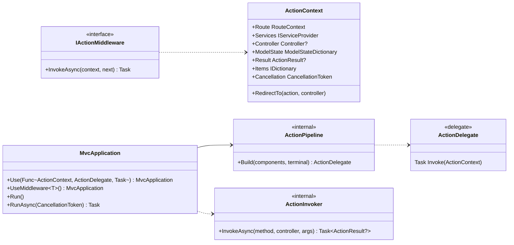
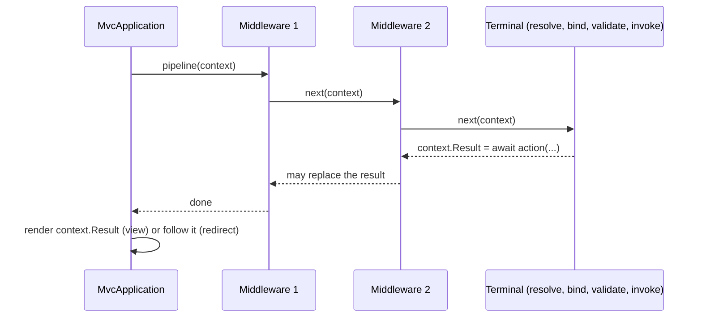

# Design: ConsoleMVC 1.6: Async actions and middleware

| | |
|---|---|
| **Author** | Mateusz Podeszwa |
| **Status** | Implemented in 1.6.0 |
| **Scope** | `Task`/`ValueTask` actions, `RunAsync`, `CancellationToken` parameters, the action pipeline (`Use`, `UseMiddleware<T>`) |

---

## 1. Goals

1. Let actions `await` I/O: `Task<ActionResult>`, `ValueTask<ActionResult>` and any `Task<T>`/`ValueTask<T>` where `T`
   is an `ActionResult` (e.g. `Task<ViewResult>`).
2. `app.RunAsync(cancellationToken)`; `app.Run()` keeps working and simply waits for `RunAsync`.
3. Pass the run's `CancellationToken` to actions that declare one.
4. Cross-cutting concerns (logging, timing, authorisation, error screens) as **middleware** around every action,
   with the same shape as ASP.NET Core: `app.Use(async (context, next) => { …; await next(context); … })`.

```csharp
using var app = builder.Build();

app.Use(async (context, next) =>
{
    var started = Stopwatch.GetTimestamp();
    await next(context);
    logger.LogInformation("{Route} took {Elapsed}", context.Route, Stopwatch.GetElapsedTime(started));
});

app.UseMiddleware<RequireSignInMiddleware>();

await app.RunAsync();
```

```csharp
public class OrdersController(IOrderStore store) : Controller
{
    public async Task<ActionResult> Index(CancellationToken cancellationToken) =>
        View(await store.ListAsync(cancellationToken));
}
```

---

## 2. Class diagram



---

## 3. One navigation cycle



A middleware **short-circuits** by setting `context.Result` (or calling `context.RedirectTo(...)`) without calling
`next`: the action does not run. It **handles errors** by wrapping `await next(context)` in `try`/`catch` and setting a
result, for example a redirect to an error screen. Middleware runs in registration order, outermost first.

Views stay synchronous (`Render` returns a `NavigationResult`) and render *after* the pipeline, so a middleware sees
the result an action produced, never half a screen.

---

## 4. Rules (pseudocode)

```
Build(components, terminal):                 # once, when the application starts
    pipeline ← terminal
    for component in reverse(components):
        pipeline ← component(pipeline)
    return pipeline

UseMiddleware<T>():
    Use((context, next) → ActivatorUtilities.GetServiceOrCreateInstance<T>(context.Services)
                              .InvokeAsync(context, next))     # per cycle, so T may depend on scoped services

Terminal(context):
    controller ← Router.ResolveController(route.Controller, context.Services)
    method     ← Router.ResolveAction(controller, route.Action)
    args       ← ModelBinder.Bind(...); CancellationToken parameters ← context.Cancellation
    validate when form data was posted
    context.Result ← await ActionInvoker.InvokeAsync(method, controller, args)

ActionInvoker.InvokeAsync(method, controller, args):
    value ← method.Invoke(controller, args)          # TargetInvocationException unwrapped
    ActionResult         → value
    Task<T> / ValueTask<T> where T : ActionResult → await, then .Result
    (adapter compiled once per method)

RunAsync(token):
    loop: token.ThrowIfCancellationRequested(); scope; await pipeline(context); render or redirect
```

`Router` treats a method as an action when it returns `ActionResult`, or `Task<T>`/`ValueTask<T>` of an
`ActionResult` type. A plain `Task` (no result) is not an action: there would be nothing to render.
