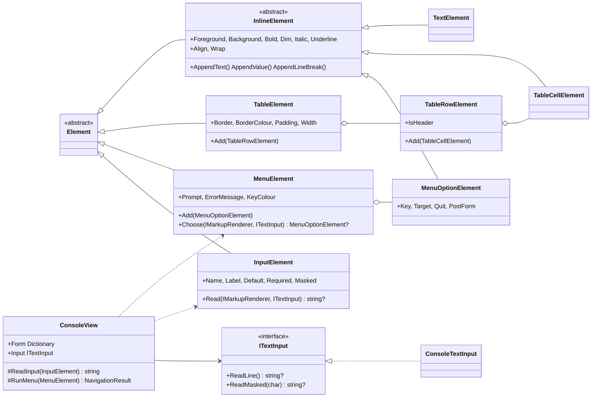
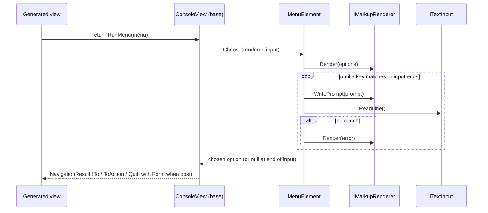

# Design: ConsoleMVC 1.3 — C-View Markup v0.2 (tables, menus, inputs)

| | |
|---|---|
| **Author** | Mateusz Podeszwa |
| **Status** | Implemented in 1.3.0 |
| **Builds on** | [C-View Markup v0.1](c-view-markup.md) |
| **Scope** | `<table>`/`<row>`/`<cell>`, `<menu>`/`<option>`, `<input>`, placement rules |

---

## 1. Goals

1. Data-driven tables that size their columns to the content and the terminal.
2. Declarative navigation: a `<menu>` replaces the usual "print options, read a line, `switch`" boilerplate.
3. Declarative form input: `<input>` collects values into the view's `Form`, ready to post to a controller.
4. Keep the rendering engine independent of MVC — interactive elements return plain data; the MVC layer turns
   the chosen option into a `NavigationResult`.
5. Keep everything testable without a real console (input is abstracted behind `ITextInput`).

```
@model MyApp.Models.UsersViewModel

<table border="rounded">
    <row header>
        <cell>Name</cell>
        <cell align="right">Age</cell>
    </row>
    @foreach (var user in Model.Users)
    {
        <row>
            <cell>@user.Name</cell>
            <cell align="right">@user.Age</cell>
        </row>
    }
</table>

<input name="Search" label="Search: " />

<menu>
    <option key="s" nav="Search" post>Search</option>
    <option key="b" nav="Home/Index">Back</option>
    <option key="q" quit>Quit</option>
</menu>
```

---

## 2. Elements

| Element | Placement | Content | Attributes |
|---|---|---|---|
| `<table>` | anywhere a block may appear | `<row>` only (control flow allowed) | `border`, `color`/`colour`, `padding`, `width` |
| `<row>` | inside `<table>` | `<cell>` only | `header` |
| `<cell>` | inside `<row>` | inline (like `<text>`) | `align`, `color`, `background`, `bold`, `dim`, `italic`, `underline`, `wrap` |
| `<menu>` | top level only; **ends the view** | `<option>` only | `prompt`, `error`, `key-color`/`key-colour` |
| `<option>` | inside `<menu>` | inline label | `key` (required), `nav` (`Controller/Action` or `Action`), `quit`, `post`, `color`/`colour` |
| `<input>` | top level only | none | `name` (required), `label`, `default`, `required`, `masked`, `color`/`colour` |

Exactly one of `nav` or `quit` is required on an `<option>` (CVW109).

### Why top level only?

A box is laid out after all its children are known, so it cannot stop half-way to read a line of input.
Interactive elements therefore run at the point they appear in the view's code — which may still be inside a C#
`if` or loop at the top level.

---

## 3. Architecture changes

### 3.1 Class diagram (new and changed types)



### 3.2 Sequence — a menu at run time



### 3.3 Generator changes

* `ElementSchema` gains placement metadata: `AllowedChildren`, `RequiredParent`, `TopLevelOnly`, a new
  `ContentModel.Elements` (element children only, no text), required attributes and an optional element validator.
* Each schema declares its **top-level statement template**:
  `this.Renderer.Render({0});` (default), `this.ReadInput({0});` (input) or `return this.RunMenu({0});` (menu).
* `MarkupParser.ParseCode` now knows its container, so placement is validated identically whether an element is
  written directly inside its parent or inside `@foreach`/`@if` within it.

---

## 4. Algorithms

### 4.1 Table column widths

```
columns ← max cells in any row
chrome  ← (border ? columns + 1 : 0) + 2 · padding · columns
natural[c] ← max over rows of cell[c].MeasureWidth(∞)
target ← table.Width.Resolve(available, sum(natural) + chrome) − chrome
widths ← natural
while sum(widths) > target and some width > 1:
    widths[argmax(widths)] −= 1           # shrink the widest column first; cells wrap
if sum(widths) < target:                  # explicit width larger than the content
    widths[last] += target − sum(widths)
```

### 4.2 Table rows

```
top border:     ┌──┬──┐
for each row:
    cellLines[c] ← cell[c].Layout(widths[c])   (missing cells are empty)
    height ← max(len(cellLines))
    emit height lines: │ c0 │ c1 │   (short cells padded with blank lines)
    if row.IsHeader and another row follows: ├──┼──┤
bottom border:  └──┴──┘
```

Header cells are bold unless the cell sets its own style.

### 4.3 Input

```
Read(renderer, input):
    loop:
        renderer.WritePrompt(label)
        value ← masked ? input.ReadMasked('*') : input.ReadLine()
        if value is null: return null                 # end of input
        value ← trim(value); if empty: value ← default ?? ""
        if required and value empty: render "This field is required." in red; continue
        return value
```

`ConsoleView.ReadInput` stores the value in `Form[name]`. At end of input the field is stored as empty.

### 4.4 Menu

```
Choose(renderer, input):
    renderer.Render(menu)                     # "[key] label" per option, labels wrap with a hanging indent
    loop:
        renderer.WritePrompt(prompt)
        line ← input.ReadLine()
        if line is null: return null          # end of input → caller quits, never loops forever
        option ← first option whose key equals trim(line), case-insensitive
        if option: return option
        renderer.Render(error)
```

`RunMenu` maps the option: `quit` → `Quit()`, `nav="C/A"` → `To(C, A)`, `nav="A"` → `ToAction(A)`; `post` adds `Form`.

### 4.5 Masked input

`ConsoleTextInput.ReadMasked` reads keys without echo, prints the mask character per key, supports Backspace, and
falls back to `ReadLine()` when input is redirected (keys cannot be intercepted). Masked values are never written
to the output.

---

## 5. New diagnostics

| Id | Severity | Meaning |
|---|---|---|
| CVW109 | Error | Element-specific rule broken (e.g. `<option>` needs exactly one of `nav` or `quit`; `nav` must be `Controller/Action` or `Action`) |
| CVW110 | Error | Text or an expression inside an element that only accepts child elements (`<table>`, `<row>`, `<menu>`) |
| CVW111 | Error | Required attribute missing (`<option key>`, `<input name>`) |

CVW103 now also covers placement: `<row>` outside `<table>`, `<cell>` outside `<row>`, `<option>` outside `<menu>`,
and `<menu>`/`<input>` inside another element.
