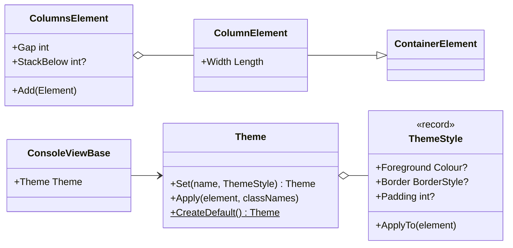

# Design: C-View Markup 1.0 (ConsoleMVC 1.9)

| | |
|---|---|
| **Author** | Mateusz Podeszwa |
| **Status** | Implemented in 1.9.0 |
| **Scope** | `<columns>`/`<column>` layout, responsive stacking, themes (`class`), `min-width`/`max-width` |

---

## 1. Goals

1. **Layout**: place content side by side (a menu next to details, two panels) with `<columns>`.
2. **Responsive sizing**: layouts adapt to the terminal: percentage widths, `min-width`/`max-width`, and columns that
   stack vertically below a chosen width.
3. **Theming**: define colours and borders once, use them everywhere with `class="…"`, as CSS classes do.

```
<columns gap="2" stack-below="70">
    <column width="30%">
        <box class="panel" title="Menu">…</box>
    </column>
    <column>
        <box title="Details" min-width="30" max-width="80">…</box>
    </column>
</columns>
```

```csharp
builder.Theme.Set("brand", new ThemeStyle { Foreground = Colour.Magenta, Bold = true });
```

---

## 2. Class diagram



---

## 3. Column widths (pseudocode)

```
Layout(W):
    if StackBelow and W < StackBelow: lay the columns out one below the other at width W
    content ← W − Gap × (n − 1)
    fixed and percent columns: Resolve(content), never more than what is left
    R ← content − their total
    auto columns: natural_i ← MeasureWidth(R)
        Σ natural ≤ R → width_i = natural_i
        otherwise water filling: in order of natural width, a column whose natural width fits an
        equal share of what is left keeps it; the rest share the remainder equally
    rows: line r = col₁[r] padded to width₁ + gap + col₂[r] padded … (last column not padded), clipped to W
```

`MeasureWidth` is the sum of the resolved widths plus gaps, so an auto-width `<box>` around columns fits them.

---

## 4. Themes

```
Emit <text class="title danger" bold="false">:
    var e = new TextElement();
    this.Theme.Apply(e, "title danger");    # classes first, in order
    e.Bold = false;                         # attributes written on the element override them

Theme.Apply(e, names): for each name split by spaces: if defined → style.ApplyTo(e)   # unknown names ignored
ThemeStyle.ApplyTo(e): copy only the properties that are set, and only those e has
```

The view's theme comes from `MvcApplicationBuilder.Theme` (registered as a singleton service) and is shared with
partials. `Theme.CreateDefault()` defines `title`, `muted`, `success`, `warning`, `danger`, `info` and `panel`.

---

## 5. Width limits

```
width ← Resolve(Width)            # auto / fixed / percent
width ← min(width, MaxWidth)      # when set
width ← max(width, MinWidth)      # when set
width ← clamp(width, 0, available)   # the container always wins
```
