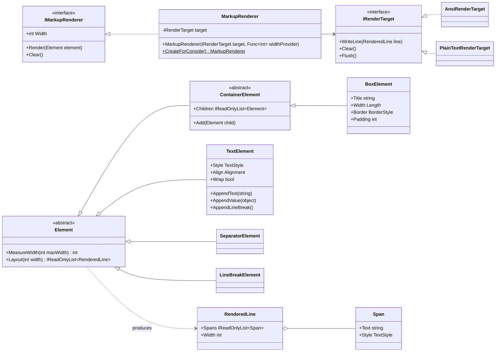
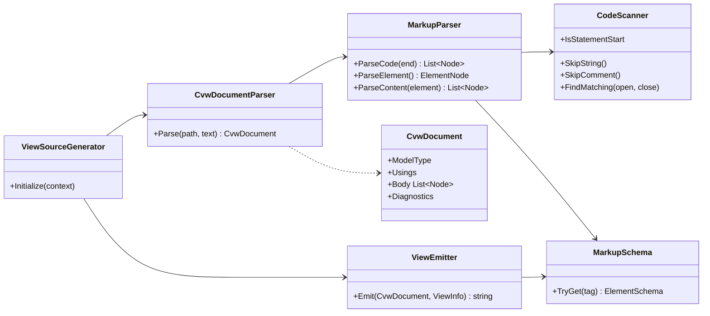
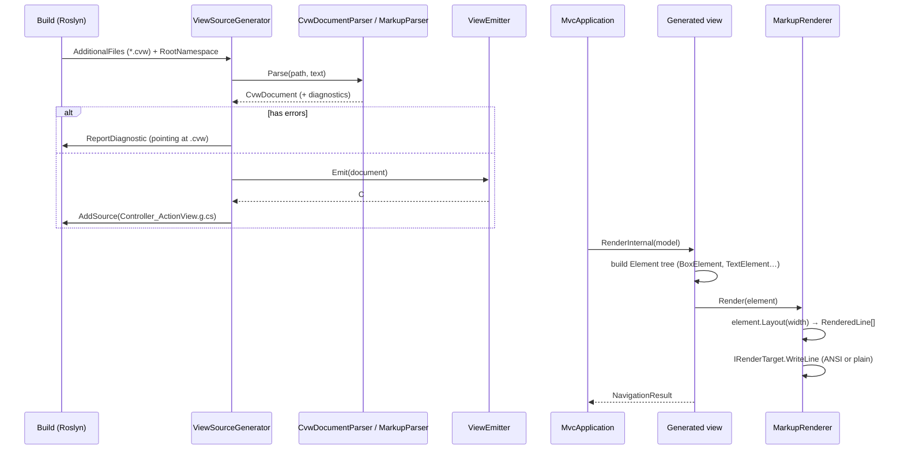

# Design: ConsoleMVC 1.2: C-View Markup v0.1 and Rendering Engine

| | |
|---|---|
| **Author** | Mateusz Podeszwa |
| **Status** | Implemented in 1.2.0 |
| **Scope** | C-View Markup v0.1 (`<text>`, `<box>`, `<separator>`, `<br>`), console rendering engine, framework bug fixes |

---

## 1. Goals

1. Let `.cvw` views describe console output declaratively instead of through dozens of `Console.WriteLine()` calls.
2. Stay **100 % backwards compatible**: every existing plain-C# `.cvw` file must compile and behave exactly as before.
3. Compile markup to plain C# at build time (no runtime template parsing).
4. Keep the rendering engine an independent API (`ConsoleMVC.Rendering`) with no dependency on the MVC layer, so it can be reused or split into its own package.
5. Report markup mistakes as **compiler diagnostics that point at the `.cvw` file**, and map C# errors in views back to the `.cvw` line via `#line` directives.
6. Be secure by default: text that comes from models is sanitised so it cannot inject terminal escape sequences.

### Non-goals for v0.1

`<table>`, `<menu>`, `<input>`, components/partials, theming, live reload. These are the next milestones (see `plannedfeatures.md`).

---

## 2. How markup mixes with C#

A `.cvw` body is still C#. Markup is recognised **only where a C# statement may begin** (after `;`, `{`, `}`, `:` or at the very start of the body) when `<` is immediately followed by a *known* tag name. C# can never begin a statement with `<`, so this is unambiguous and plain-C# views are unaffected.

```
@model MyApp.Models.DashboardViewModel

<box title="Dashboard" width="60" border="double" padding="1">
    <text align="centre" color="cyan" bold>Welcome, @Model.UserName!</text>
    <separator />
    @foreach (var item in Model.Notifications)
    {
        <text>• @item</text>
    }
</box>

Console.Write("Press Enter to continue...");
Console.ReadLine();
return NavigationResult.ToAction("Index");
```

* Top-level markup is rendered **immediately, in source order**, so it interleaves naturally with `Console.ReadLine()` and friends.
* Inside an element, `@` switches back to C#:

| Syntax | Meaning |
|---|---|
| `@Model.Name`, `@items[0]`, `@user.GetName()` | Implicit expression (identifier, `.`, `?.`, `(...)`, `[...]` chains) |
| `@(a + b)` | Explicit expression |
| `@if (...) { ... } else { ... }`, `@foreach`, `@for`, `@while`, `@switch` | Control flow; the block body is C# that may contain markup |
| `@{ var x = 1; }` | Code block |
| `@@` | Literal `@` |
| `name@example.com` | `@` preceded by a letter or digit is literal (e-mail addresses) |
| `@* comment *@`, `<!-- comment -->` | Comments (not rendered) |
| `&lt; &gt; &amp; &quot; &apos; &nbsp; &#64;` | Character entities |

### Whitespace

Literal text inside `<text>` follows HTML rules: runs of whitespace collapse to one space and leading/trailing whitespace is trimmed. Use `<br />` for an explicit line break. Values from `@expressions` are inserted as-is (after sanitisation).

---

## 3. Elements (v0.1)

| Element | Kind | Attributes |
|---|---|---|
| `<text>` | block, inline content | `color`, `background`, `align` (`left`/`centre`/`center`/`right`), `bold`, `dim`, `italic`, `underline`, `wrap` (default `true`) |
| `<box>` | block container | `title`, `width` (`auto`, `40`, `50%`), `border` (`single`, `double`, `rounded`, `heavy`, `ascii`, `none`), `padding`, `color` (border colour), `title-color` |
| `<separator>` | void block | `style` (`single`, `double`, `heavy`, `ascii`, `dashed`), `color`, `width` |
| `<br>` | void block | `count` |

Bare text directly inside `<box>` is wrapped in an implicit `<text>`.

Colours: the 16 console colours by name (`red`, `darkred`, `grey`/`gray`, `darkgrey`, …) or `#rgb` / `#rrggbb` true colour. Attribute values are either literals (validated at compile time) or `@expr` / `@(expr)` (type-checked by the C# compiler).

---

## 4. Architecture

### 4.1 Package/folder layout

```
src/ConsoleMVC/                       (assembly ConsoleMVC, package ConsoleMVC.Framework)
  Application/   MvcApplication, MvcApplicationBuilder
  Controllers/   Controller
  Results/       ActionResult, ViewResult, RedirectToActionResult, NavigationResult
  Routing/       Router, RouteContext
  Binding/       ModelBinder
  Views/         ConsoleView, ConsoleView<T>, ViewDataDictionary
  Rendering/     ← independent API, namespace ConsoleMVC.Rendering, no MVC dependency
    Styling/     Colour, TextStyle, BorderStyle, LineStyle, Alignment, Length
    Text/        TextWidth, TextSanitiser, TextWrapper
    Layout/      Span, RenderedLine
    Elements/    Element, ContainerElement, TextElement, BoxElement, SeparatorElement, LineBreakElement
    Output/      IRenderTarget, AnsiRenderTarget, PlainTextRenderTarget, TerminalCapabilities, WindowsConsoleMode
    IMarkupRenderer, MarkupRenderer, MarkupValue

src/ConsoleMVC.Generators/            (Roslyn incremental generator, netstandard2.0)
  ViewSourceGenerator                 (pipeline wiring only)
  Parsing/      CvwDocumentParser, CodeScanner, MarkupParser, SourceText helpers
  Syntax/       CvwDocument, nodes (CodeNode, ElementNode, TextNode, ExpressionNode, …)
  Schema/       MarkupSchema, ElementSchema, AttributeSchema, AttributeKind
  Emit/         ViewEmitter, AttributeEmitter, CSharpWriter
  Diagnostics/  CvwDiagnostics (descriptors), ParseDiagnostic
```

### 4.2 Class diagram: rendering engine



### 4.3 Class diagram: generator



### 4.4 Sequence: build time and run time



---

## 5. Grammar (pseudo-BNF)

```
cvw-file        = directive* body
directive       = "@model" SP type NL | "@using" SP namespace NL
body            = code-node*

code-node       = csharp-text | element          ; element only at statement start
statement-start = BOF | after one of ";" "{" "}" ":" (ignoring whitespace/comments)

element         = "<" tag-name attribute* ( "/>" | ">" content "</" tag-name ">" )
attribute       = name [ "=" ( quoted-literal | "@" implicit-expr | "@(" csharp ")" ) ]
content         = ( text | entity | "@@" | expression | control-flow | code-block
                  | element | comment )*
expression      = "@" implicit-expr | "@(" csharp ")"
implicit-expr   = identifier ( "." identifier | "?." identifier | "(" … ")" | "[" … "]" )*
control-flow    = "@" ( "if" | "foreach" | "for" | "while" | "switch" ) header "{" code-node* "}"
                  [ "else" ( "if" header )? "{" code-node* "}" ]*
code-block      = "@{" code-node* "}"
comment         = "<!--" … "-->" | "@*" … "*@"
```

---

## 6. Generator pseudocode

```
Parse(path, text):
    doc ← new CvwDocument
    pos ← ParseDirectives(text, doc)            # @model / @using, unchanged rules
    doc.ModelType ← doc.ModelType ?? "object"   # @model is now optional
    doc.Body ← MarkupParser(text, pos).ParseCode(until: EOF)
    return doc

ParseCode(until):
    nodes ← []; codeStart ← pos
    while pos < until:
        if at string/char/comment: scanner.Skip…(); continue
        if char = '<' and scanner.IsStatementStart and schema.Has(PeekTagName()):
            flush code[codeStart..pos] into nodes
            nodes.add(ParseElement())
            codeStart ← pos; continue
        track brace depth / last significant char; pos++
    flush remaining code
    return nodes

ParseElement():
    read "<" tag attributes
    if "/>" or schema(tag).IsVoid: return element
    element.Children ← ParseContent(element)
    expect "</" tag ">"   else diagnostic CVW102

ParseContent(element):
    loop until "</":
        "<!--"           → skip comment
        "<" tag          → child ← ParseElement(); validate schema.AllowsChild
        "@@"             → text "@"
        "@*"             → skip comment
        "@("             → ExpressionNode(scanner.FindMatching('(', ')'))
        "@{"             → CodeNodes(ParseCode(until matching '}'))
        "@" keyword      → header ← scan to '{'; ParseCode(block); chain else-branches
        "@" identifier   → ExpressionNode(ScanImplicitExpression())
        "&entity;"       → decoded text
        otherwise        → text char

Emit(doc):
    write usings, namespace, class {Action}View : ConsoleView<Model>
    write Render(Model) { EmitNodes(doc.Body, parent: null) }

EmitNodes(nodes, parent):
    for node in nodes:
        CodeNode     → "#line N file" + padding + code + "#line hidden"
        ElementNode  → EmitElement(node, parent)
        inline runs  → group into implicit TextElement when parent is a container

EmitElement(el, parent):
    v ← fresh variable
    "{ var v = new global::ConsoleMVC.Rendering.<Type>();"
    for attr: AttributeEmitter.Emit(v, attr)       # literal → typed constant, @expr → assignment
    children: text → v.AppendText("…"), expr → v.AppendValue(expr), element → EmitElement(child, v)
    parent = null ? "this.Renderer.Render(v);" : "parent.Add(v);"
    "}"
```

---

## 7. Diagnostics

| Id | Severity | Meaning |
|---|---|---|
| CVW001 | Warning | `.cvw` file is not inside `Views/{Controller}/` and was skipped |
| CVW002 | Error | File or folder name is not a valid C# identifier |
| CVW100 | Error | Unknown attribute on element |
| CVW101 | Error | Invalid attribute value |
| CVW102 | Error | Missing or mismatched closing tag |
| CVW103 | Error | Element not allowed in this context |
| CVW104 | Error | Unterminated expression, code block or string |
| CVW105 | Error | Unknown element inside markup |
| CVW106 | Error | Control flow or code block not allowed inside `<text>` |
| CVW107 | Error | Duplicate attribute |

---

## 8. Bugs fixed in 1.2.0

| # | Area | Problem | Fix |
|---|---|---|---|
| 1 | Routing | View lookup was case-sensitive while controller lookup was not: `NavigationResult.To("home", "index")` found the controller and action but then failed with *View not found*. | Views use a case-insensitive key; `View()` uses the resolved method name. |
| 2 | Routing | Any public method was routable (`get_ViewData`, `ToString`, `GetType`), causing `InvalidCastException`. Overloaded actions threw `AmbiguousMatchException`. | Only public instance methods returning `ActionResult` declared on a controller are actions; overloads report a clear error. |
| 3 | Application | A custom `ActionResult` subclass (or `null`) re-invoked the same action forever. | Unsupported results throw a descriptive `InvalidOperationException`. |
| 4 | Application | Exceptions thrown inside actions surfaced as `TargetInvocationException`. | The original exception is rethrown with its stack trace preserved. |
| 5 | Application | `Console.Clear()` throws `IOException` when output is redirected (Windows, CI, piping). | Clearing goes through the renderer, which skips clearing for redirected output. |
| 6 | Application | `Assembly.GetEntryAssembly()` may be `null`; `GetTypes()` may throw `ReflectionTypeLoadException`. | Clear error / load the types that did resolve. |
| 7 | Binding | Missing form keys overwrote value-type property initialisers with `0`/`false` (e.g. `int Age = 18` became `0`). | Properties are only assigned when the key is present. |
| 8 | Binding | A failed conversion of a simple parameter ignored the parameter's declared default value. | The declared default is used. |
| 9 | Views | A `null` model for a value-type `@model`, or a wrong model type, crashed with an unhelpful cast exception. | Descriptive `InvalidOperationException` naming the view and both types. |
| 10 | Generator | Missing `@model` or a misplaced file were silently ignored, giving a confusing *View not found* at run time. | `@model` defaults to `object`; misplaced files raise CVW001. |
| 11 | Generator | Compile errors pointed at the generated `.g.cs` file instead of the `.cvw` file. | `#line` directives map view code back to the `.cvw` source. |
| 12 | Generator | Generated code relied on `ImplicitUsings`; with them disabled, `Console` was unresolved. | Generated files import `System`, `System.Collections.Generic` and `System.Linq` explicitly. |
| 13 | Generator | The controller name was taken from the first `Views` folder in the path, so a project inside a folder named `Views` got the wrong namespace; nested folders could produce duplicate classes. | The controller is the folder directly inside `Views`; anything else raises CVW001. |
| 14 | Generator | Generated public classes triggered CS1591 in projects with XML documentation enabled. | Generated files suppress CS1591. |
| 15 | Generator | Generated file names could collide, making the generator fail and drop every view. | Hint names include the namespace and a path hash; duplicate classes report CVW004. |
| 16 | Generator | `#line` paths were C#-escaped, breaking non-ASCII and Windows paths. | Paths are written verbatim. |
| 17 | Generator | No `#nullable` directive in generated code. | `#nullable restore`. |
| 18 | Parser | Comments before `else`, preprocessor lines, e-mails in attributes, `@a@b`, entities in unquoted values, whitespace across comments. | Each handled; see regression tests. |
| 19 | Rendering | Lines wider than their width at small widths or large padding; percentage children sized twice; `Length` overflow. | Padding shrinks to fit, lines are clipped, relative children make auto parents fill, 64-bit arithmetic. |
| 20 | Binding | Newer value types and `Uri` never bound; undefined enum numbers accepted. | Added to the simple types; enums validated. |
