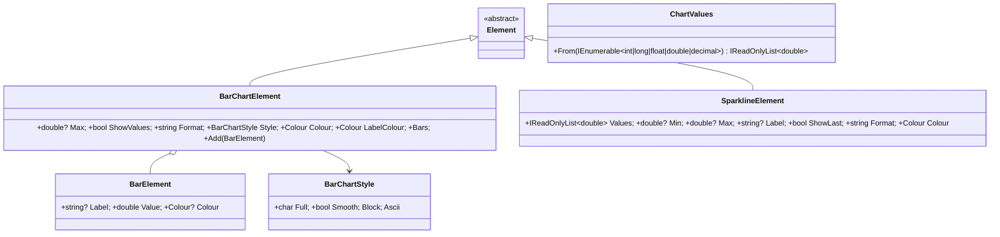

# Design: ConsoleMVC 1.25: Charts

| | |
|---|---|
| **Author** | Mateusz Podeszwa |
| **Status** | Implemented in 1.25.0 |
| **Scope** | `BarChartElement`, `BarElement`, `BarChartStyle`, `SparklineElement`, `ChartValues`, `<bar-chart>`, `<bar>`, `<sparkline>` |

---

## 1. Problem

Dashboards show numbers that are easier to compare as shapes: sales per day, queue length over the last minute. A
`<table>` lists them; a chart lets the eye compare them. Both elements must fit the width they are given, like every
other element, and work with plain ASCII.

## 2. Markup

```
<bar-chart format="N0" color="cyan">
    @foreach (var day in Model.Days)
    {
        <bar label="@day.Name" value="@day.Sales" />
    }
</bar-chart>

Mon  ████████████████████▌            1,240
Tue  ████████████▏                      750
Wed  ██████████████████████████████   1,810

<sparkline label="Queue " values="@Model.QueueHistory" show-last />
Queue ▁▂▂▃▅▇█▆▄▃▂▁ 3
```



## 3. Bar chart layout

```
Layout(width):
    bars ← Bars; if none: no lines
    max ← Max ?? largest value; values below 0 count as 0; max ≤ 0 or not finite → every bar empty
    labelWidth ← min(widest label, width / 3)          # labels are shortened with an ellipsis beyond that
    valueWidth ← ShowValues ? widest formatted value : 0
    area ← max(width − labelWidth − 1 − (valueWidth > 0 ? valueWidth + 1 : 0), 1)
    for each bar:
        exact ← value / max × area
        Smooth: full cells ← ⌊exact⌋, then one partial block from ▏▎▍▌▋▊▉ for the remaining eighths (8 eighths → a full cell)
        otherwise: cells ← round(exact) of Full
        line: label padded to labelWidth, " ", bar (bar.Colour ?? Colour) padded to area, " ", value right-aligned
```

Values are formatted with `Format` (a .NET format string, default `0.##`) in the current culture.

## 4. Sparkline layout

```
Layout(width):
    tail ← ShowLast and Values not empty ? " " + format(last value) : ""
    cells ← width − label − tail; when there are more values than cells, the most recent ones are shown
    low ← Min ?? smallest finite value; high ← Max ?? largest finite value
    each value: not finite → " "; high = low → "▄"; else level ← round((clamp(v) − low) / (high − low) × 7) → "▁▂▃▄▅▆▇█"[level]
MeasureWidth: label + number of values + tail (a sparkline is as wide as its data)
```

## 5. Values from any number type

`values="@Model.Visits"` is wrapped in `ChartValues.From(…)`, which has overloads for sequences of `int`, `long`,
`float`, `double` and `decimal`, so a `List<int>` works without a conversion. A literal list is also accepted:
`values="3, 5, 2, 8"` (commas or spaces), checked at build time.
