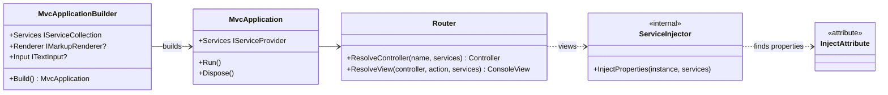
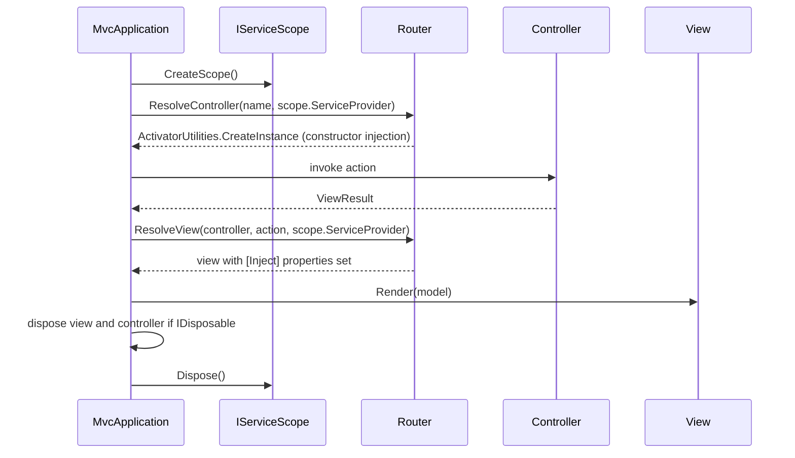

# Design: ConsoleMVC 1.5: Dependency injection

| | |
|---|---|
| **Author** | Mateusz Podeszwa |
| **Status** | Implemented in 1.5.0 |
| **Scope** | `builder.Services`, scoped navigation cycles, constructor injection into controllers, `@inject` in views |

---

## 1. Goals

1. Register services with the standard `Microsoft.Extensions.DependencyInjection` container, with the same
   `IServiceCollection` API as ASP.NET Core (`AddSingleton`, `AddScoped`, `AddTransient`).
2. Inject services into **controllers** through their constructors.
3. Inject services into **views** with an `@inject Type Name` directive, as in Razor.
4. Give every navigation cycle (one action and the view it renders) its own **scope**, so a scoped service such as a
   unit of work lives exactly as long as one screen.
5. Stay backwards compatible: applications that never touch `builder.Services` behave exactly as before, and
   `builder.Renderer` / `builder.Input` keep working.

```csharp
var builder = MvcApplication.CreateBuilder(args);
builder.Services.AddSingleton<IGreetingService, GreetingService>();
builder.Services.AddScoped<IBasket, Basket>();

using var app = builder.Build();
app.Run();
```

```csharp
public class HomeController(IGreetingService greetings) : Controller
{
    public ActionResult Index() => View(greetings.Greet("Ada"));
}
```

```
@model string
@inject IGreetingService Greetings
<text>@Model - @Greetings.Tagline</text>
```

---

## 2. Class diagram



The generator turns `@inject IGreetingService Greetings` into

```csharp
[global::ConsoleMVC.Mvc.Inject]
public IGreetingService Greetings { get; private set; } = default!;
```

(mapped with `#line` to the directive, so a misspelt type is reported in the `.cvw` file).

---

## 3. Navigation cycle



A redirect ends the cycle: the next action gets a new scope.

---

## 4. Rules (pseudocode)

```
Build():
    services ← copy of builder.Services            # Build() never mutates the user's collection
    if builder.Renderer set: services.AddSingleton(builder.Renderer)      # last registration wins
    else:                    services.TryAddSingleton(_ => MarkupRenderer.CreateForConsole())
    if builder.Input set:    services.AddSingleton(builder.Input)
    else:                    services.TryAddSingleton(ConsoleTextInput.Instance)
    provider ← services.BuildServiceProvider(ValidateScopes = true)

InjectProperties(instance, services):
    for each property p of instance's type with [Inject] (cached per type):
        p.SetValue(instance, services.GetService(p.PropertyType)
                             ?? throw "View 'X' injects 'T Name', but no service of type 'T' is registered.")
```

`ValidateScopes` is on, so resolving a scoped service from the root provider (for example from a singleton's
constructor) fails immediately instead of silently creating an application-lifetime instance.

---

## 5. Diagnostics

| Id | Severity | When |
|---|---|---|
| CVW007 | Error | `@inject` without a type and a property name, or the name is not a valid identifier |
| CVW008 | Error | Two `@inject` directives declare the same property name |
