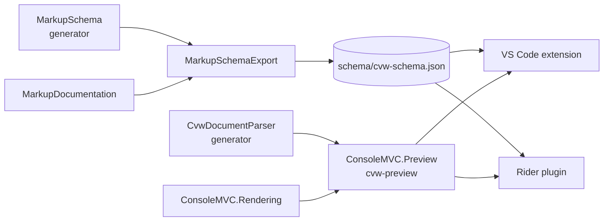
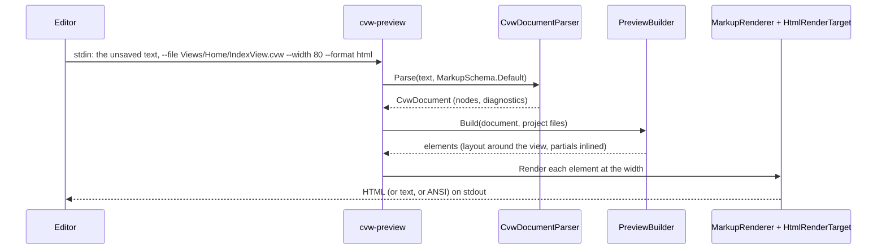

# Design: ConsoleMVC 1.34: Editor support

| | |
|---|---|
| **Author** | Mateusz Podeszwa |
| **Status** | Implemented in 1.34.0 |
| **Scope** | `schema/cvw-schema.json` (`MarkupSchemaExport`, `MarkupDocumentation`), the `ConsoleMVC.Preview` tool (`cvw-preview`), and the editor plugins in [ConsoleMVC-CVWSupport](https://github.com/MateuszPodeszwa/ConsoleMVC-CVWSupport) |

---

## 1. Problem

Editors treat `.cvw` files as plain text, or, in the Rider plugin, as the plain C# of ConsoleMVC 1.x. Writing markup
means remembering every element, attribute and value, and seeing a screen means building and running the application.

## 2. Goals

- Highlighting, completion, hover documentation and early checks for C-View Markup in VS Code and Rider.
- A live preview of a view while it is edited, drawn by the real rendering engine.
- One description of the markup, owned by the framework: editors must never fall out of step with the generator.

## 3. Structure



### 3.1 The schema file

`MarkupSchemaExport.ToJson(MarkupSchema.Default)` writes the generator's own schema, so the file cannot describe an
element the generator does not know. A generator test compares it with the checked-in `schema/cvw-schema.json` and
fails when they differ; `UPDATE_SCHEMA=1 dotnet test` rewrites it. Another test checks that every value the schema
offers for completion passes the generator's validation.

```text
{ formatVersion: 1,
  directives:  [ { name, syntax, description } ],            @model @using @inject @layout @refresh
  constructs:  [ { syntax, description } ],                  @expr @(…) @{…} @if @foreach @*…*@ @@ &lt;
  elements:    [ { name, description, content: void|inline|block|elements, topLevelOnly,
                   parents: [..] | null, children: [..] | null,
                   attributes: [ { name, description, required, kind, accepts, flag, interpolation,
                                   values?, minimum?, maximum? } ] } ],
  diagnostics: [ { id, severity, title } ] }
```

`kind` is one of `text`, `integer`, `number`, `number-list`, `date`, `boolean`, `colour`, `length`, `choice`, `route`
and `model`. Descriptions live in `MarkupDocumentation`, keyed by the attribute's runtime property so aliases share one
text, with `tag.Property` overrides; the export fails when one is missing, so a new element cannot ship undescribed.
Fields are only added; a change of meaning raises `formatVersion`.

### 3.2 The preview tool



```text
Build(nodes):
    code nodes (@if, @foreach, @{ })     → skipped: no C# runs, every element is drawn once
    element node                          → new runtime element (the schema's runtime type, created by reflection)
        class="…"                         → theme.Apply(element, classes)
        literal attribute                 → checked by the attribute's AttributeType, converted to the property's type
                                            (string, bool, int, decimal, double, Colour, Length, number list, an
                                            enum member or a predefined value such as BorderStyle.Double)
        attribute with @expressions       → text properties get "{Model.Name}"; other kinds keep their default,
                                            number lists get a sample series and a numeric value="@…" a sample
                                            number (30, 50, 20, …), so charts and bars are visible
        inline content                    → AppendText, with "{expression}" for each @expression; <br /> → AppendLineBreak
        block content                     → children; runs of text become an implicit <text> (as the emitter does)
    <partial name="X" />                  → the project's Views/Shared/X.cvw (any case, the first file by path, as the
                                            build finds it; an area's views use it too), built in place (depth ≤ 8)
    the view                              → drawn inside @layout's (or _Layout's) layout: the part before <body />,
                                            then the view, with the part after <body /> just before the view's first
                                            field or menu (or at the end), as ConsoleView.UseLayout draws it
Render: Theme.CreateDefault() (or high contrast), MarkupRenderer at --width, one element after another
Output: html  → <pre> with a <span style> per run of one style, colours from ConsolePalette
        text  → plain lines;  ansi → AnsiRenderTarget
        diagnostics → a list after the screen (html) or on stderr, with line and column
Check (ViewChecks): ViewSourceGenerator.CheckFile(path)   → CVW001, CVW002, CVW003, CVW009
                    ViewSourceGenerator.CheckMarkup(document, view, partials, no routes)
                                                          → the parser's diagnostics, then CVW010, CVW103, CVW114 to CVW118
                    partials: ViewSourceGenerator.PartialEntryFor(each Views/Shared file; the view's unsaved text for itself)
```

- **Diagnostics** come from the generator's own methods, which the build calls too, so they cannot drift apart. Route
  checks (CVW119 to CVW121) are left out: they need the project's controllers from a compilation, and compiling the
  project's C# without MSBuild is slow (about half a second per preview) and wrong whenever the project relies on
  generated code such as implicit usings. CVW004 and CVW005 need the other views and the project file. A shared view
  over the size limit, or more than 1000 of them, leaves the checks that need them out, with a note, rather than
  guessing.

- **Interactive elements** are drawn by their own `Read` (fields) or `Choose` (`<menu>`) through `PreviewScreen`, a
  renderer that can rewrite, with a terminal input that has already ended: they draw exactly the frame a terminal
  shows when they first wait (a checked `<checkbox>` ticked, a `<number>` or `<date>` with its default, a `<select>`
  or `<radio>` with its default highlighted, an `<input>` or `<menu>` with its prompt), and the prompt's line is
  ended as Enter would. `<scroll>` shows all of its content.
- **Safety**: the tool runs no user code and loads no assembly from the project. It reads only the view and the
  `.cvw` files directly in the project's `Views/Shared`; partial and layout names are checked to be plain identifiers
  before they are looked up.
- The tool is a `dotnet tool` (`dotnet tool install -g ConsoleMVC.Preview`), released with the framework at the same
  version. It references the generator's parser through `InternalsVisibleTo`, so it parses exactly as the build does.

### 3.3 The editors

The plugins live in ConsoleMVC-CVWSupport and read the schema file: the VS Code extension (TextMate grammar,
completion, hover, diagnostics, snippets and a preview panel that runs `cvw-preview` on every change, debounced), and
the Rider plugin (lexer, highlighting, completion, annotator and a preview tool window). They are released separately.

## 4. Testing

- `SchemaExportTests`: the checked-in file is current, valid JSON, describes everything, and offers only valid values.
- `PreviewTests`: each kind of attribute value, inline and block content, implicit text, expressions as placeholders,
  code skipped, partials and layouts resolved (and refused outside the project), interactive elements, the HTML output's
  colours and escaping, diagnostics, and the command line.
- `PreviewMatchesTheAppTests` and `PreviewDiagnosticsTests`: the same views are compiled and run with the real
  generator and runtime (the generator tests' `ViewHarness`), and the preview must draw what a terminal shows and report
  what the build reports.
