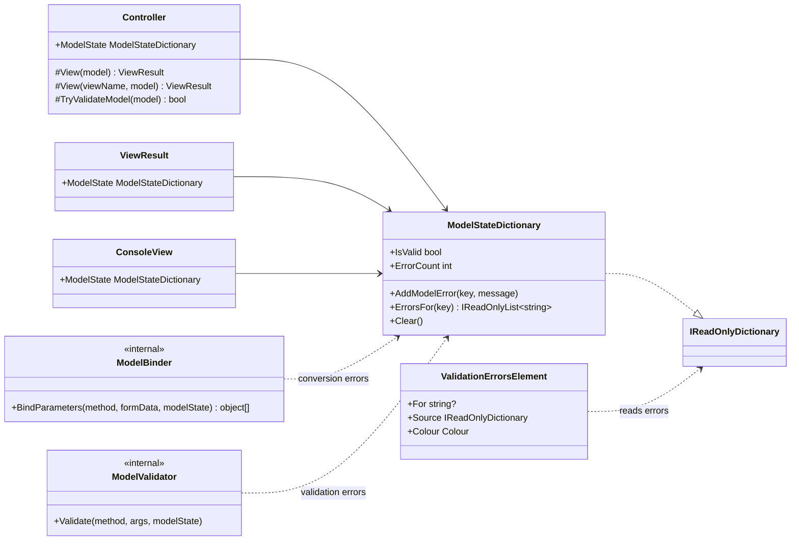
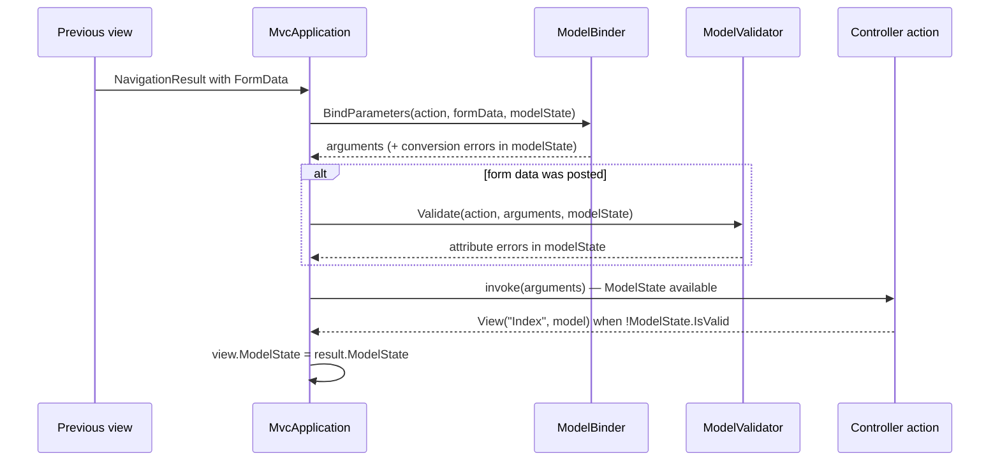

# Design: ConsoleMVC 1.4 — Form validation

| | |
|---|---|
| **Author** | Mateusz Podeszwa |
| **Status** | Implemented in 1.4.0 |
| **Scope** | Model state, binding errors, DataAnnotations validation, `<errors>` markup element |

---

## 1. Goals

1. Validate posted form data **before the action runs**, using the standard
   `System.ComponentModel.DataAnnotations` attributes (`[Required]`, `[StringLength]`, `[Range]`, `[EmailAddress]`,
   `[RegularExpression]`, …) — the same attributes and the same `ModelState.IsValid` pattern as ASP.NET Core MVC.
2. Report values that cannot be converted (e.g. `"abc"` for an `int`) instead of silently using the default.
3. Let views show the errors with one markup element: `<errors />` (all) or `<errors for="Name" />` (one field).
4. Stay backwards compatible: actions that never look at `ModelState` behave exactly as before.

```csharp
public class SignupModel
{
    [Required, StringLength(30)]
    public string Name { get; set; } = "";

    [Range(13, 120)]
    public int Age { get; set; }
}

public ActionResult Save(SignupModel model)
{
    if (!ModelState.IsValid)
        return View("Index", model);       // show the form again with its errors

    return RedirectToAction("Done");
}
```

```
<errors />
<input name="Name" label="Name: " />
<input name="Age" label="Age: " />
<menu><option key="s" nav="Save" post>Save</option></menu>
```

---

## 2. Class diagram



`ValidationErrorsElement` lives in `ConsoleMVC.Rendering` and depends only on
`IReadOnlyDictionary<string, IReadOnlyList<string>>`, which `ModelStateDictionary` implements — the rendering
engine stays independent of MVC.

---

## 3. Request pipeline



---

## 4. Rules (pseudocode)

```
BindParameters(method, formData, state):
    for each parameter p:
        simple type:  raw present and not convertible → state.Add(p.Name, "The value 'raw' is not valid for p.Name.")
                      value ← converted, or declared default
        complex type: create instance; for each simple property with a key present:
                      not convertible → state.Add(property.Name, …); keep the initialiser

Validate(method, args, state):            # only when form data was posted
    for each parameter p with value v:
        simple:  for each ValidationAttribute on p → if invalid: state.Add(p.Name, message)
        complex: Validator.TryValidateObject(v, validateAllProperties: true)
                 → each result: state.Add(memberName, message)
                 (properties that already have a conversion error are not re-validated,
                  so the user sees one clear message per field)
```

Keys are case-insensitive and match the form field names (`<input name="…">`), not `model.Property` paths, so
`<errors for="Name" />` works for both simple parameters and model properties.

Numbers and dates are parsed with the invariant culture (`1.5`, `2026-10-27`), independently of the user's locale,
so that a form behaves identically on every machine.
