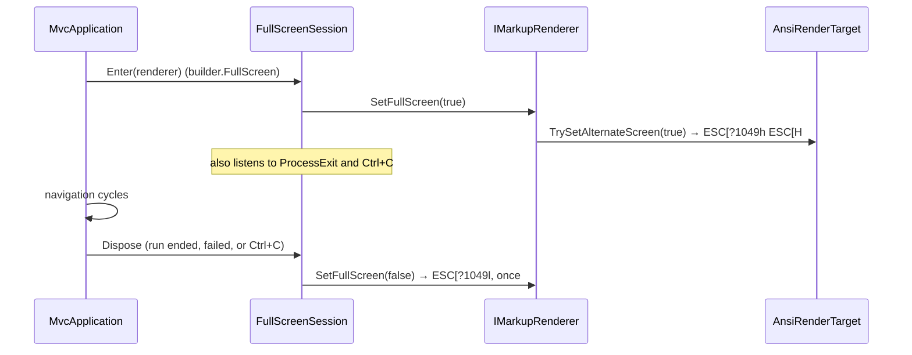

# Design: ConsoleMVC 1.27: Full-screen mode and scrolling

| | |
|---|---|
| **Author** | Mateusz Podeszwa |
| **Status** | Implemented in 1.27.0 |
| **Scope** | `MvcApplicationBuilder.FullScreen`, `FullScreenSession`, `IRenderTarget.TrySetAlternateScreen`, `IMarkupRenderer.Height` and `SetFullScreen`, `ScrollElement`, `<scroll>` |

---

## 1. Problem

1. A console application draws over the user's scrollback: after it ends, the shell history is buried under old
   screens. Full-screen programs (editors, pagers) use the terminal's **alternate screen** instead.
2. A long table or log runs off the top of the window, and the user cannot read it back without scrolling the terminal.

Redrawing when the terminal is resized already exists ([responsive redraw](responsive-redraw.md)).

## 2. Full-screen mode



- `IRenderTarget.TrySetAlternateScreen` defaults to `false`: plain text, files and the legacy Windows console API have
  no alternate screen, so `FullScreen` is ignored there. `AnsiRenderTarget` writes the sequences.
- The session is disposed before an exception reaches the caller, so an error message is printed on the normal screen.
- Switching resets the renderer's screen history, so a resize redraw never replays the other screen.

## 3. `<scroll>`: a pager

```
ScrollElement : ContainerElement     # its children are the content
    Height: int?                     # lines per page; null → window height − 3 (status line, prompt, one spare)
    Layout(width): every line        # inside another element, or with no terminal, nothing is hidden

Show(renderer, input):
    lines ← Layout(renderer.Width); page ← PageSize()
    if lines fit in page, or the renderer cannot rewrite, or the input cannot read keys: Render(this); return
    top ← 0; Render(page of lines from top + status "Lines 1-12 of 40  ↑↓ PgUp PgDn Home End  Enter continues")
    loop on keys:
        ↑ K: top − 1   ↓ J: top + 1   PgUp B: top − page   PgDn Space: top + page   Home: 0   End: last page
        Enter, Esc, Q, end of input: stop
        lay out again (the window may have been resized), clamp top, Rewrite the page
    Rewrite the page without the status line   # it stays on the screen; the view goes on below it
```

- `<scroll>` waits for the user, so it is a top-level element, like a field: generated code calls `ShowScroll(scroll)`.
  It does not draw a layout's footer; the footer still comes before the first field or menu.
- A mapped shortcut pressed while scrolling leaves the screen, as it does in any field.
- In tests (`MvcTestHost`), the output has no height, so content only pages when `height` is set.
