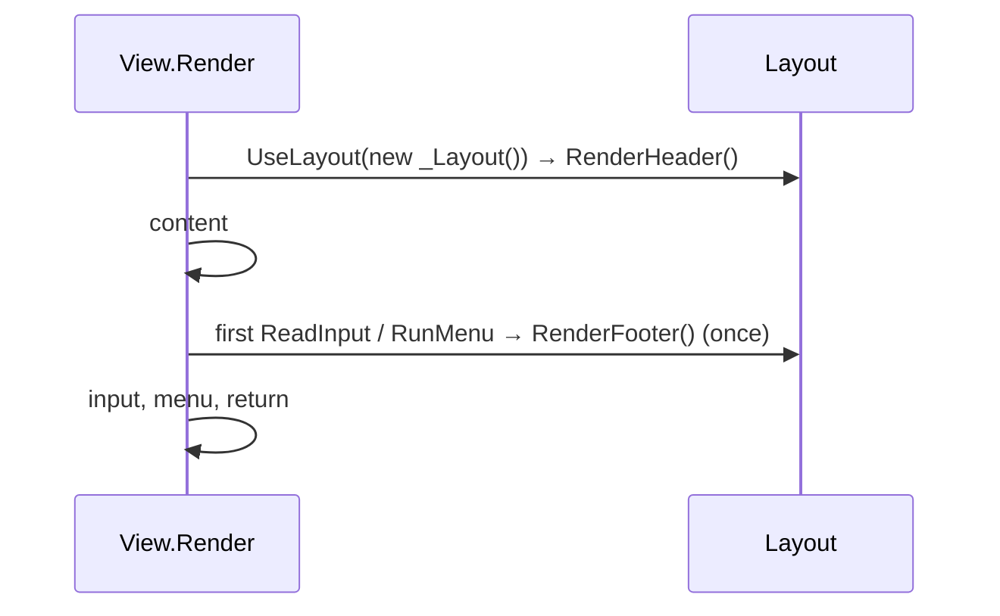

# Design: ConsoleMVC 1.11: Layout views

| | |
|---|---|
| **Author** | Mateusz Podeszwa |
| **Status** | Implemented in 1.11.0 |
| **Scope** | `<body />`, `@layout`, `Views/Shared/_Layout.cvw`, `ConsoleLayoutView`, CVW117 and CVW118 |

---

## 1. Goal

One file frames every screen, like `_Layout.cshtml` in ASP.NET Core: an app bar, a status line, a separator above the
menu. Views stop repeating the same `<partial>` at the top.

```
@* Views/Shared/_Layout.cvw *@
<text class="muted" align="right">My App</text>
<body />
<separator />
```

## 2. Where the footer goes

A web page is laid out and then shown; a console screen is drawn top to bottom and ends where it waits for the
user. A footer drawn after the view returns would appear after the user has already chosen where to go, and would
be cleared at once. So:

- the **header** (markup before `<body />`) is drawn before the view;
- the **footer** (markup after `<body />`) is drawn just before the view first waits for the user (its first
  `<input>` or `<menu>`, also inside partials), or when the view returns if it never waits.



## 3. Rules (pseudocode)

```
Generator
    file in Views/Shared with <body />  → class Name : ConsoleLayoutView
                                           RenderHeader() { nodes before <body /> }
                                           RenderFooter() { nodes after <body /> }
    full view → layout ← @layout Name | none | (no directive → _Layout if it exists)
                Render(Model) { this.UseLayout(new Shared.Name()); …view… }

Checks
    <body /> outside Views/Shared, twice, inside an element or a C# block   → CVW117 (CVW103 inside an element)
    layout with @model or @layout                                           → CVW117
    @layout Name that is missing or not a layout; @layout in a partial      → CVW118
    <partial name="X"> where X is a layout                                  → CVW114

Runtime
    UseLayout(layout): share state (renderer, ViewData, ModelState, Form, Theme, services, @inject);
                       layout.RenderHeader(); BeforeInteraction ← CompleteLayout
    ReadInput, RunMenu (views and partials): BeforeInteraction?.Invoke()
    RenderInternal: after Render returns → CompleteLayout()
    CompleteLayout: once → layout.RenderFooter()
```

Partials never get a layout (they are drawn inside one), and layouts cannot nest.
