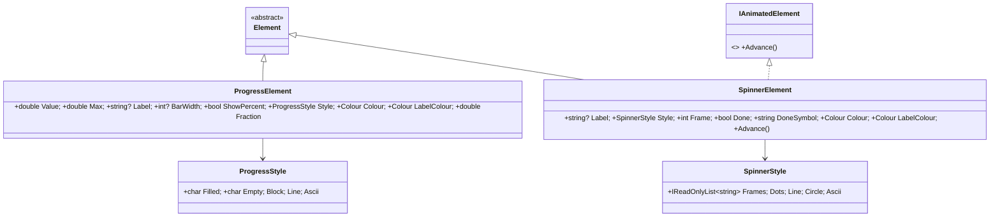
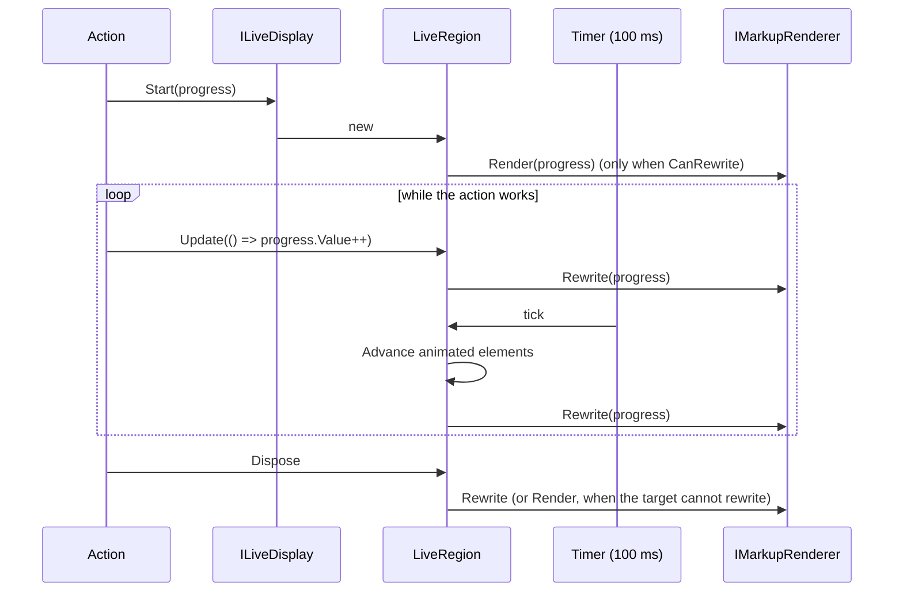
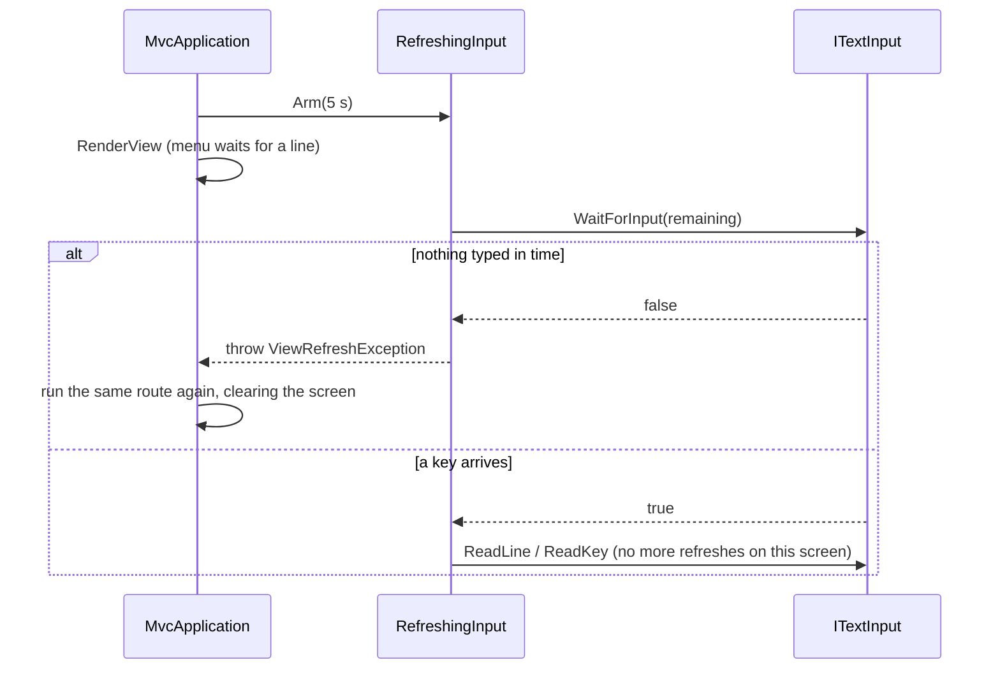

# Design: ConsoleMVC 1.24: Live elements and timed refresh

| | |
|---|---|
| **Author** | Mateusz Podeszwa |
| **Status** | Implemented in 1.24.0 |
| **Scope** | `ProgressElement`, `SpinnerElement`, `ILiveDisplay` and `LiveRegion`, `@refresh` and `ViewResult.RefreshEvery`, `ITextInput.WaitForInput`, `ScriptedInput.Wait` |

---

## 1. Problem

A screen is drawn once and then waits for the user. Two common needs do not fit that:

1. **Long actions.** An action that imports files or calls a service runs before its view is drawn, so the user stares at
   the previous screen with no sign that anything is happening.
2. **Dashboards.** A status page should show fresh numbers every few seconds without the user pressing a key.

## 2. Elements

```
<progress value="@Model.Done" max="@Model.Total" label="Import " />    Import ████████░░░░░░░░  50%
<spinner label="Connecting" />                                          ⠋ Connecting
<spinner label="Connected" done />                                      ✓ Connected
```



```
ProgressElement.Layout(width):
    fraction ← clamp(Value / Max, 0, 1)    # 0 when Max ≤ 0 or either value is not a number
    label ← sanitised Label; percent ← " " + round(fraction × 100) right-aligned to 4 columns, when ShowPercent
    bar ← BarWidth ?? width − label − percent (at least 1)
    filled ← round(fraction × bar)
    one line: label, Filled × filled (Colour), Empty × (bar − filled), percent; clipped to width

SpinnerElement.Layout(width):
    symbol ← Done ? DoneSymbol : Style.Frames[Frame mod count]
    one line: symbol (Colour) + " " + Label (LabelColour); clipped to width
SpinnerElement.Advance(): Frame ← (Frame + 1) mod count
```

## 3. Live regions: updating while an action runs



```
LiveRegion(renderer, element, interval, time):
    if renderer.CanRewrite: renderer.Render(element); timer ← time.CreateTimer(Tick, interval)
    # pipes and files cannot erase lines: nothing is drawn until the region ends, so a log shows the final state once

    Update(change):  lock { change(); Draw() }
    Tick():          lock { if not disposed: Advance every IAnimatedElement in the tree; Draw() }
    Dispose():       lock { once: stop the timer; CanRewrite ? Rewrite(element) : Render(element) }
    Draw():          if CanRewrite: renderer.Rewrite(element)
```

- `ILiveDisplay` is registered as a singleton (`LiveDisplay`), so controllers and services take it in their
  constructor: `LiveRegion Start(Element element, TimeSpan? interval = null)`.
- The element must be the last thing drawn while the region is live: `Rewrite` replaces the last element.
- The region's lock serialises the timer and the action's updates; the renderer's own lock keeps a resize redraw out of
  the middle of a rewrite.
- The interval defaults to 100 ms and must be between 20 ms and one minute.

## 4. Timed refresh

```
@refresh 5s                                        # in a view: refresh every 5 seconds
return View(model).RefreshEvery(TimeSpan.FromSeconds(5));   # or from the action (this wins)
```



```
ITextInput.WaitForInput(timeout) → bool        # default: true (cannot tell, so read and block as before)
ConsoleTextInput.WaitForInput:  redirected input → true; else poll Console.KeyAvailable until the timeout
ScriptedInput.Wait():           a step meaning "time passes"; WaitForInput consumes it and returns false

RefreshingInput (wraps the application's input, outermost)
    Arm(interval?): deadline ← now + interval; answered ← false      # before each view
    before every ReadLine / ReadMasked / ReadKey:
        if interval and not answered:
            if not inner.WaitForInput(max(deadline − now, 0)): throw ViewRefreshException
            answered ← true
```

- **Refresh pauses while the user answers.** Once a key arrives on a screen, it waits for the user like any other.
- A refresh runs the same route again (the action fetches fresh data), records the same screen in the history (so Back
  is not affected) and always clears the screen first.
- `@refresh` takes `ms`, `s` or `m` (`500ms`, `5s`, `1.5s`, `2m`), from 100 ms to 24 hours; anything else is CVW010.
  Partial views and layouts cannot refresh (CVW010): the view decides.
- Inputs that cannot wait (pipes, inputs that do not implement `WaitForInput`) never refresh.
