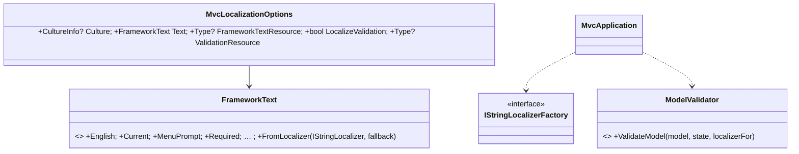

# Design: ConsoleMVC 1.29: Localisation

| | |
|---|---|
| **Author** | Mateusz Podeszwa |
| **Status** | Implemented in 1.29.0 |
| **Scope** | `FrameworkText`, `MvcLocalizationOptions` (`builder.Localization`), `IStringLocalizer` registration, localised validation in `ModelValidator` |

---

## 1. Problem

An application for users who do not read English needs three things translated: its own text (titles, labels), the
framework's text (menu prompts, "This field is required.", the pager's status line) and validation messages. Numbers
and dates should be formatted for the user's culture.

## 2. Design



```
RunAsync:
    culture ← Localization.Culture ?? setting ConsoleMVC:Culture (unknown name → InvalidOperationException) ?? none
    if culture: CurrentCulture ← CurrentUICulture ← culture            # restored when the run ends
    text ← FrameworkTextResource ? FrameworkText.FromLocalizer(factory.Create(resource), Text) : Text
    using FrameworkText.Use(text)                                       # AsyncLocal: per run, per async flow
    … navigation cycles; elements read FrameworkText.Current for every message and prompt

FromLocalizer(localizer, fallback):
    copy of fallback; for each string property P: resource P found → P ← its value

Validation (LocalizeValidation):
    localizer ← factory.Create(ValidationResource ?? model type (or controller type, for simple parameters))
    display ← localizer[[Display(Name)] ?? property name], when found
    each failed attribute:
        ErrorMessage set (and no ErrorMessageResourceType) and localizer has it:
            message ← Format(translation, display, the attribute's own arguments)
                      StringLength: max, min · Range: min, max · MinLength/MaxLength: length · Length: min, max
                      RegularExpression: pattern · Compare: other property
        otherwise: the produced message, translated as a whole when the localizer has it
    property attributes, then type attributes, then IValidatableObject, as Validator.TryValidateObject orders them
```

- `IStringLocalizer<T>` and `IStringLocalizerFactory` are registered with `AddLocalization()` (only what is missing),
  so views use `@inject IStringLocalizer<SharedResource> L` and `@L["Key"]`; `builder.Services.AddLocalization(o =>
  o.ResourcesPath = "Resources")` sets where the `.resx` files are.
- `FrameworkText.Current` is an `AsyncLocal`, so concurrent runs (remote sessions) can use different languages.
- Messages are composite format strings; a translation with broken placeholders is shown as it is rather than failing.
- Without `LocalizeValidation`, validation works exactly as before.
