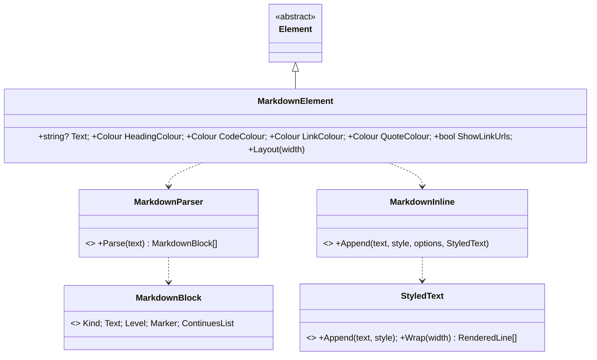

# Design: ConsoleMVC 1.26: Markdown

| | |
|---|---|
| **Author** | Mateusz Podeszwa |
| **Status** | Implemented in 1.26.0 |
| **Scope** | `MarkdownElement`, `MarkdownParser`, `MarkdownInline`, `StyledText`, `<markdown />` |

---

## 1. Problem

Help pages, release notes and descriptions are usually written in Markdown. Showing them in a console application
meant printing the raw text, `**stars**` and all. `<markdown text="@Model.Notes" />` draws it for the terminal instead.

## 2. Design



### Blocks

| Markdown | Drawn as |
|---|---|
| `# Title` to `###### Title` | bold (level 1 also underlined), in `HeadingColour` |
| paragraph lines | joined with spaces and wrapped; two trailing spaces or `\` break the line |
| `-`, `*`, `+` items, `1.` items | `•` or the number, with a hanging indent; two spaces of indentation nest one level (up to 6) |
| `> quote` | `│ ` before each line, in `QuoteColour` |
| ```` ``` ```` or `~~~` fences | the lines as they are, indented by two, in `CodeColour`, clipped rather than wrapped |
| `---`, `***`, `___` | a rule across the width |

One blank line separates blocks, except after a heading (it belongs to what follows) and between the items of one list.

### Inline

```
Parse(state, index, closer, style):
    loop over characters, spending one step of state.Budget each
        at closer (a delimiter that can close: follows text; "_" not inside a word) → return closed
        "\" + punctuation → the punctuation, literally
        `code` (n backticks close n backticks) → CodeColour, nothing inside is formatted
        [label](address) → label (underlined, LinkColour), then " (address)" dimmed when ShowLinkUrls and it differs
        <https://…> → the address, as a link
        "*", "**", "_", "__" that can open (followed by text; "_" not inside a word),
            when the same delimiter can close later on (precomputed) and there is budget left:
                parse the inside with Italic or Bold added; closed → use it; otherwise keep the delimiter as text
        anything else → text
```

- **Bounded work.** Each delimiter only opens when a matching closer exists further on, and the parse has a budget of
  32 steps per character; past it, delimiters are kept as text. Long or hostile input stays fast.
- **Safe output.** `StyledText` and code lines sanitise everything, so Markdown from users or files cannot send
  terminal escape sequences. Links are text: nothing is opened or fetched, and no terminal hyperlink is written.
- HTML, tables and images are not interpreted; they are shown as text.

### Wrapping styled text

`StyledText` keeps a style per character, wraps the plain text with `TextWrapper` (which only drops the spaces at a
break and the line feeds between paragraphs), then walks the wrapped lines against the source to give each character
its style back, merging neighbours with the same style into one span.
