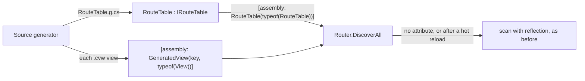

# Design: ConsoleMVC 1.32: Native AOT and trimming

| | |
|---|---|
| **Author** | Mateusz Podeszwa |
| **Status** | Implemented in 1.32.0 |
| **Scope** | `IRouteTable`, `ControllerRoute`, `ActionRoute`, `ViewRoute`, `RouteTableAttribute`, `GeneratedViewAttribute`, `Router.Use`, generated `InjectServices`, trimming annotations, generic route values overloads |

---

## 1. Problem

The router found controllers and views by scanning the assembly (`Assembly.GetTypes`), created them with
`ActivatorUtilities` and called actions with `MethodInfo.Invoke`. That costs start-up time, and when an application is
trimmed or compiled with Native AOT the trimmer cannot see what reflection needs, so it removes it: constructors,
action methods, model properties.

## 2. Design



```
Generated RouteTable (one per assembly with controllers or views):
    Controllers: new ControllerRoute("Admin/Users", typeof(UsersController),
                     services => new UsersController(services.GetRequiredService<IUserStore>()),     # one public constructor
                     [ new ActionRoute("Details", typeof(UsersController).GetMethod("Details", [typeof(int)])!,
                                       (c, a) => ActionRoute.FromTask(((UsersController)c).Details((int)a![0]!))) ])
    Views:       hand-written views; .cvw views register themselves with GeneratedViewAttribute (only views that compiled)
    [DynamicDependency(PublicProperties | PublicConstructors, typeof(Model))]   # every complex action parameter type,
                                                                              # its property types and element types (depth 4)

Router.DiscoverAll(assembly):
    RouteTableAttribute → Use(table) + GeneratedViewAttributes; else scan
    ResolveController: table factory ?? ActivatorUtilities           ResolveView: factory ?? ActivatorUtilities
    ResolveAction: table method (and its invoker) ?? reflection       InvokeAction: table invoker ?? ActionInvoker (reflection)
```

- **Views inject without reflection.** A view with `@inject` overrides `InjectServices` with plain assignments
  (`this.Clock = RequireService(services, this.Clock, "Clock")`, the type inferred so errors stay at the directive);
  `ServiceInjector` only reflects over hand-written `[Inject]` properties.
- **Fallbacks keep everything working.** A controller with several public constructors (or defaults) has no factory and
  is created by `ActivatorUtilities`; generic or `ref` actions are called by reflection; after a hot reload the
  application scans, since the table describes the assembly as it was built.
- **Route values.** `RedirectToAction(action, new { id })`, `RedirectToAction(action, controller, values)`,
  `NavigationResult.To(controller, action, values)` and `RouteValues.From(values)` gained generic overloads whose type
  parameter is annotated `[DynamicallyAccessedMembers(PublicProperties)]`; the compiler picks them for anonymous objects
  and classes, so the trimmer keeps the properties. The `object` overloads are `[RequiresUnreferencedCode]`.
- **The framework is analysed** (`IsAotCompatible`). Reflection that remains (model binding, DataAnnotations validation,
  hand-written views, scanning) is suppressed with a justification that names what keeps the members: the route table's
  `DynamicDependency` attributes, or a path that only runs without a table.
- **Proven in CI.** The template is published with `PublishAot=true`; the job fails on any IL warning and runs the
  native binary.

Measured on the template (Linux x64): first screen in about 18 ms as Native AOT against about 280 ms with the JIT; a
6.8 MB self-contained executable.
