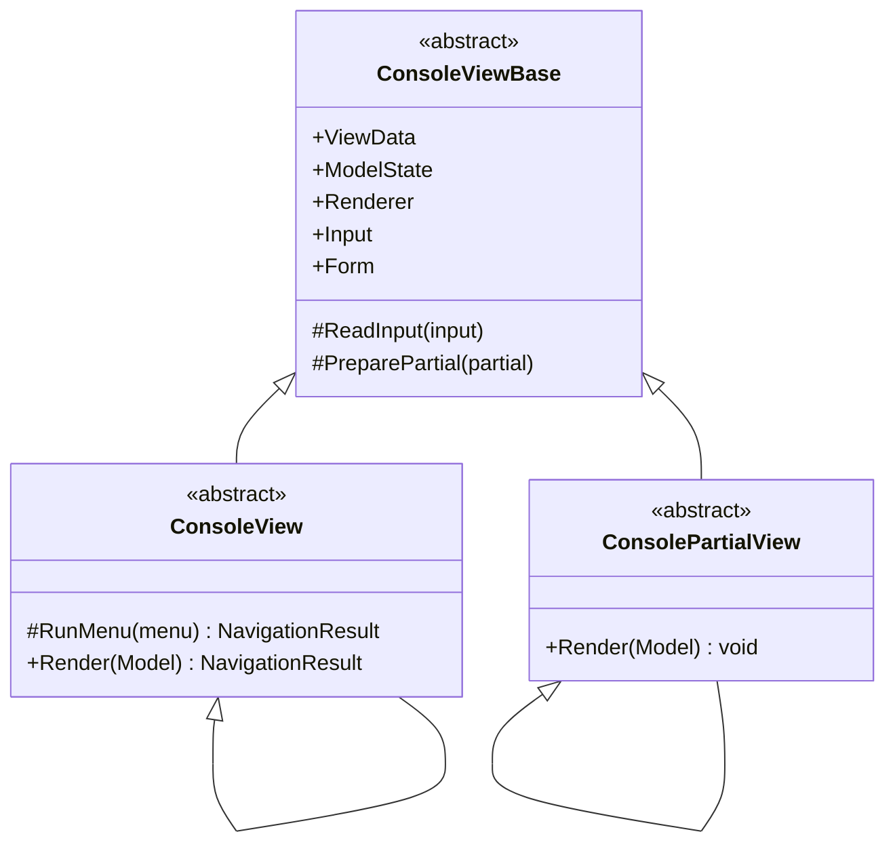
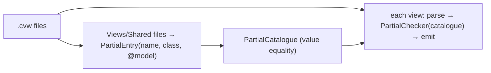

# Design: ConsoleMVC 1.7: Partial views

| | |
|---|---|
| **Author** | Mateusz Podeszwa |
| **Status** | Implemented in 1.7.0 |
| **Scope** | `Views/Shared/*.cvw`, `ConsolePartialView<TModel>`, the `<partial>` element, CVW114–CVW116 |

---

## 1. Goals

1. Reuse markup across views (headers, footers, cards, form fields) written once as a `.cvw` file.
2. Check every use **at build time**: the partial exists, it gets a model when it needs one, and the model has the
   right type (the C# compiler checks a direct call, so a wrong type is an error in the view that passes it).
3. A partial shares the including view's renderer, input, view data, model state and form, so `<input>` inside a
   partial fills the view's `Form` and `<errors />` shows the view's validation errors.
4. No runtime lookup and no reflection: `<partial>` compiles to `new Header().Render(model)`.

```
@* Views/Shared/Header.cvw *@
@model string
<box border="double" align="centre">@Model</box>
<br />
```

```
@* Views/Home/IndexView.cvw *@
@model HomeViewModel
<partial name="Header" model="@Model.Title" />
<text>@Model.Message</text>
<menu>…</menu>
```

---

## 2. Class diagram



The router discovers `ConsoleView` subclasses only, so a partial can never be navigated to.

---

## 3. Generator pipeline



Only a partial's name and `@model` feed the catalogue, so editing a partial's body regenerates that partial alone.

---

## 4. Rules (pseudocode)

```
ViewInfo.IsPartial ← folder == "Shared"          # Views/Shared/{Name}.cvw; no "View" suffix needed (no CVW003)

Emit class:
    partial → class {Name} : ConsolePartialView<TModel> { override void Render(TModel Model) { body } }
    view    → class {Name} : ConsoleView<TModel>        { override NavigationResult Render(TModel Model) { body } }

PartialChecker(document, info, catalogue):
    for each element e (nested included):
        e is <menu> and info.IsPartial         → CVW103 (a menu ends the view; a partial cannot)
        e is <partial>:
            name contains an expression        → CVW114 (must be literal, to check it at build time)
            name not in catalogue              → CVW114 (lists the available partials)
            info.IsPartial and name is itself  → CVW116
            partial has @model and no model=   → CVW115

Emit <partial name="N" model="M" />:          # top level only, like <input>
    { var p = new global::{Root}.Views.Shared.N(); this.PreparePartial(p); p.Render(M or default!); }

PreparePartial(p):
    p.ViewData, ModelState, Renderer, Input, Form, Services ← this view's
    fill p's @inject properties from Services
```

Indirect recursion (A renders B, B renders A) is not detected at build time; it fails at run time with a stack
overflow, as it would in hand-written C#.
