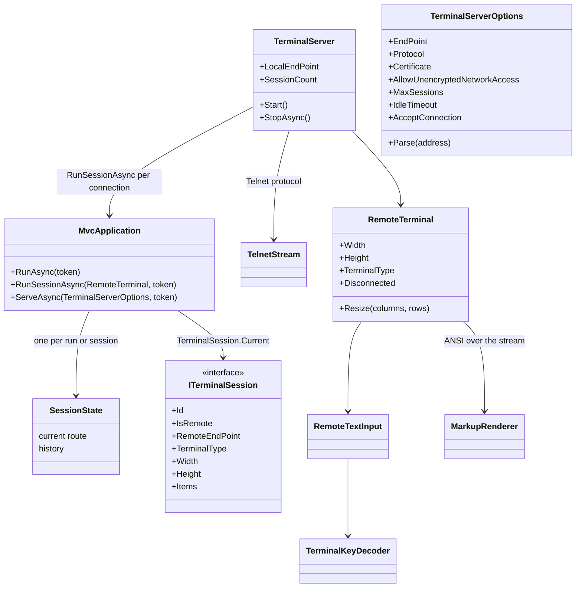
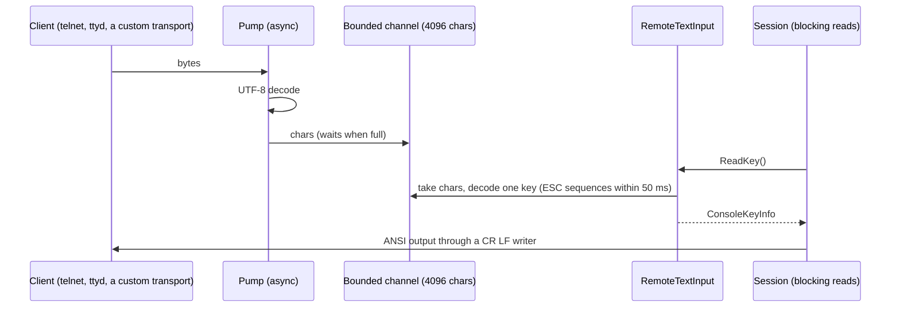

# Design: ConsoleMVC 1.33: Remote sessions

| | |
|---|---|
| **Author** | Mateusz Podeszwa |
| **Status** | Implemented in 1.33.0 |
| **Scope** | `RemoteTerminal`, `TerminalServer`, `TerminalServerOptions`, `MvcApplication.RunSessionAsync` and `ServeAsync`, `ITerminalSession`, the `ConsoleMVC:Serve` settings |

---

## 1. Problem

A ConsoleMVC application runs in the terminal that started it. To offer it to several people at once (a kiosk, a shared
admin tool, a game), each person needs their own screen, input and navigation, served from one process.

## 2. Goals and non-goals

- One process serves many **sessions**; each has its own renderer, input, current screen, history and per-session items.
- Controllers, views, middleware and services are shared, exactly as in a local run; scoped services stay per cycle.
- Secure by default: the server listens on the loopback address only, refuses a network address without TLS unless the
  developer opts out, limits sessions, buffers and terminal sizes, and drops idle connections.
- Any transport can be plugged in: `RemoteTerminal` takes plain streams.
- Not a goal: an SSH server inside the framework (SSH needs key exchange, host keys and user authentication, which
  OpenSSH already does well). SSH and web terminals are served by putting OpenSSH or `ttyd` in front (section 7).

## 3. Structure



## 4. Sessions in the application

The run's mutable state moves out of `MvcApplication` into a `SessionState` (current route and history), created by
every `RunAsync` and every `RunSessionAsync`. The router, pipeline, shortcuts and services stay shared.

```
RunSessionAsync(terminal, token):
    discover controllers and views once (later sessions reuse the router; hot reload still rediscovers)
    session ← new TerminalSession(terminal)            (Id, endpoint, size, Items)
    TerminalSession.Current ← session                   (AsyncLocal, like FrameworkText.Current)
    renderer ← terminal.Renderer   (ScreenReaderRenderer around plain text when the app uses screen-reader mode)
    input    ← terminal.Input      (then MouseDecoder, ShortcutInput or LineEditingInput, echoing to the terminal)
    run the same loop as a local run, with a new SessionState
```

- `ITerminalSession` is resolved from services (`[Inject] ITerminalSession Session`, or a constructor parameter). In a
  local run it describes the console (`IsRemote` false, Id `local`).
- `ILiveDisplay` is registered as a session-aware wrapper: a progress bar or spinner draws on the terminal of the
  session that started it.
- `IMarkupRenderer` and `ITextInput` resolved from services stay the server's console; views draw with their own
  `Renderer` and `Input`, which the framework sets per session.
- Culture and `FrameworkText` are applied per run as before; both flow with the session's async context.

## 5. The remote terminal



```
TerminalKeyDecoder.Next():
    c ← read
    '\r' → Enter (a following '\n' or NUL is dropped);  '\n' → Enter
    DEL or BS → Backspace;  TAB → Tab;  NUL → nothing
    Ctrl+C → end of the session;  Ctrl+D, Ctrl+Z → end of input (as on the console)
    other control characters → Ctrl+letter
    ESC:
        nothing within 50 ms → Escape
        "[<"            → passed on as typed (MouseDecoder reads it)
        "[8;rows;colst" → a window size report: Resize, no key
        CSI params final:  A B C D H F → arrows, Home, End;  Z → Shift+Tab;
                           n~ → Home 1/7, Insert 2, Delete 3, End 4/8, PageUp 5, PageDown 6, F1 to F12 (11 to 24)
                           a second parameter m → modifiers (m − 1: Shift 1, Alt 2, Ctrl 4)
        "O" P Q R S H F → F1 to F4, Home, End
        a printable character → Alt + that key
    printable → its key (letters A to Z with Shift for capitals, digits D0 to D9, Space)
```

- Output goes through a writer that turns every lone `\n` into `\r\n`, because the remote terminal is in raw mode, and
  through `TextWriter.Synchronized`, because resize redraws come from the pump.
- `Resize` clamps to 1 to 1000 columns and 1 to 500 rows, then redraws when the width changed.
- `WaitForInput(timeout)` waits on the channel, so `@refresh` screens refresh remotely too.
- When the stream ends, the client is idle longer than `IdleTimeout`, or the session presses Ctrl+C, reads return
  the end of input and the session ends as a local run does when its input ends.

## 6. The server

```
TerminalServer.Start():
    refuse a non-loopback EndPoint without Certificate unless AllowUnencryptedNetworkAccess
    listen; for each connection:
        AcceptConnection(endpoint) is false → close
        SessionCount ≥ MaxSessions → write BusyMessage, close
        stream ← network stream;  Certificate → SslStream (TLS 1.2 or 1.3), handshake within 10 s
        Telnet → TelnetStream: send IAC WILL ECHO, WILL SGA, DO NAWS, DO TTYPE;
                 wait up to 500 ms for the size and terminal type
        Raw    → ask the terminal for its size (ESC [ 18 t)
        terminal ← new RemoteTerminal(...);  run app.RunSessionAsync(terminal, server token) on its own task
        log the start and the end; an exception ends that session only
StopAsync(): stop listening, cancel and close every session, wait for them
```

`TelnetStream` strips commands from the input: `IAC IAC` is the byte 255, `IAC WILL/WONT/DO/DONT x` is skipped,
`IAC SB NAWS w w h h IAC SE` resizes, `IAC SB TTYPE IS name IAC SE` names the terminal; subnegotiations longer than
64 bytes are dropped. UTF-8 output never contains the byte 255, so output needs no escaping.

Settings, for running without code changes:

| Setting | Meaning |
|---|---|
| `ConsoleMVC:Serve` | Serve instead of running locally: `2323`, `127.0.0.1:2323` or `[::]:2323` |
| `ConsoleMVC:ServeProtocol` | `Telnet` (default) or `Raw` |
| `ConsoleMVC:ServeCertificate` | A PKCS #12 file for TLS |
| `ConsoleMVC:ServeCertificatePassword` | Its password |
| `ConsoleMVC:ServeMaxSessions` | The session limit (default 16) |

`Run` and `RunAsync` serve when `ConsoleMVC:Serve` is set, until Ctrl+C or the token is cancelled.

## 7. SSH and web terminals

- **SSH**: OpenSSH authenticates the user and starts one process per connection, which is the most secure option:
  `ForceCommand /opt/shop/Shop` in `sshd_config` (a Native AOT build starts in milliseconds). `ITerminalSession` is then
  the local console and `SSH_CONNECTION` and `USER` tell who is connected. For one process for everyone, serve on the
  loopback address with `Raw` and use `ForceCommand sh -c 'stty raw -echo; exec nc 127.0.0.1 2323'`.
- **Web**: `ttyd` serves any terminal program in the browser: `ttyd --writable ./Shop` (one process per tab) or
  `ttyd --writable telnet 127.0.0.1 2323` (one process, many sessions).

## 8. Threading

`ITextInput` is synchronous, so each session blocks one thread while it waits for a key. `RunSessionAsync` starts the
session with `TaskCreationOptions.LongRunning`, on a thread of its own: the caller is never blocked, and sessions do
not take thread-pool threads until an action awaits something that is not finished. `MaxSessions` (default 16) bounds
the threads used. Cancelling the token disconnects the terminal, so a session waiting for a key ends too, and
`RunSessionAsync` then throws `OperationCanceledException`, as `RunAsync` does.

## 9. Testing

- `TerminalKeyDecoderTests`: every key and sequence above, split sequences, a lone Escape, UTF-8, mouse reports,
  size reports.
- `TelnetStreamTests`: commands stripped, `IAC IAC`, NAWS and TTYPE, commands split across reads.
- `RemoteTerminalTests`: output with CR LF, echoed line editing, resize redraws, end of input, idle timeout.
- `TerminalServerTests`: a real loopback server with two concurrent clients on different screens, the session limit,
  the refused network address, TLS with a self-signed certificate, `ITerminalSession` items, stopping the server.
