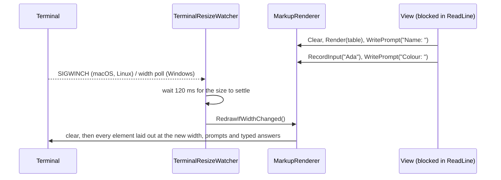

# Design: ConsoleMVC 1.10: Redraw on terminal resize

| | |
|---|---|
| **Author** | Mateusz Podeszwa |
| **Status** | Implemented in 1.10.0 |
| **Scope** | `MarkupRenderer` screen history, `TerminalResizeWatcher`, `ForeignOutputTracker` |

---

## 1. Problem

A screen is laid out once, at the width the terminal has when it is drawn. Making the window narrower afterwards
makes the terminal re-wrap the lines already on screen, so a table or box breaks onto new lines; making it wider
leaves the layout narrow. Terminals cannot re-layout text they did not lay out, so the application has to redraw.

## 2. Design



```
MarkupRenderer
    history ← entries since the last Clear: element | prompt | typed input
    Clear():  clear the screen; history ← []; ownsScreen ← true; renderedWidth ← Width
    Render(e) / WritePrompt(p) / RecordInput(t): append to history (stop recording past 2000 entries)

    RedrawIfWidthChanged():              # any thread, under the renderer's lock
        if not ownsScreen or history incomplete or Width == renderedWidth: return false
        clear the screen; replay history at the new Width; renderedWidth ← Width

ForeignOutputTracker (Console.Out)
    a write outside Suppress() → renderer.MarkForeignOutput()   # history incomplete for this screen
    the renderer and ConsoleTextInput (echo of typed text) write inside Suppress()
```

- **Only screens the renderer owns are redrawn.** Before the first clear the screen holds what was there before the
  application started; after `Console.WriteLine` from a view, that output cannot be laid out again. Both are left alone.
- **Typed answers survive** because `<input>` and `<menu>` record them (masked input as mask characters).
- **Thread safety:** rendering and redrawing take the same lock, so a resize during rendering waits for it.
- A view waiting for input keeps the characters typed so far in the runtime's line buffer; a redraw does not show
  them again until the user presses Enter (they are not lost).
- Opt out with `MarkupRenderer.CreateForConsole(redrawOnResize: false)`.
